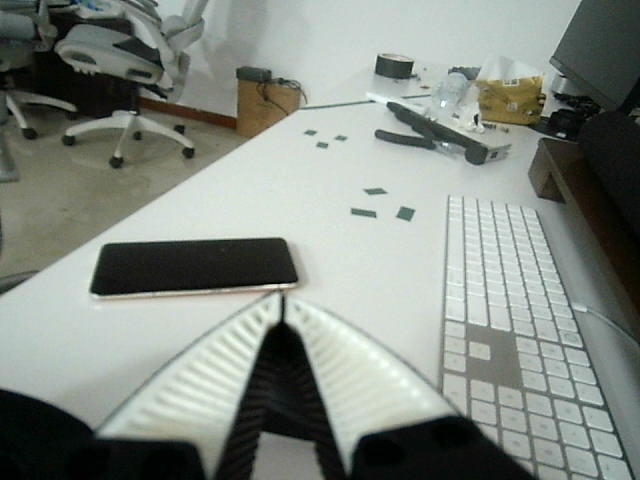
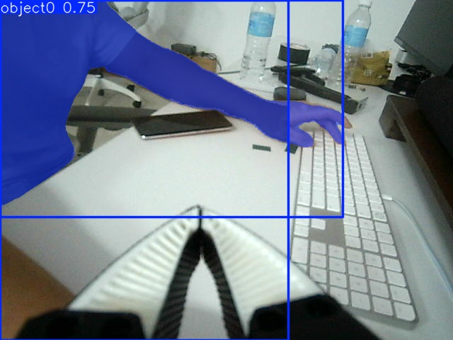
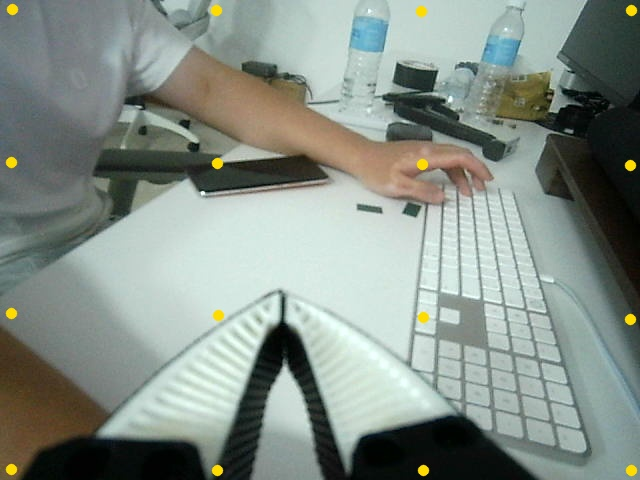
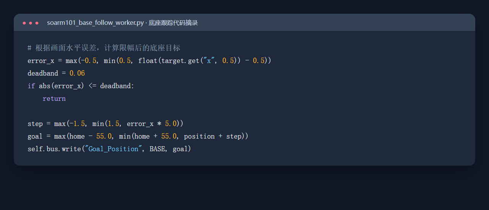

# 给 SO-101 装上眼睛和耳朵：一个桌面机器人交互原型的开发记录

**摘要：** 我想做一台能与人长期共处的桌面机器人：它能看到我、听到我，在合适的时候回应，也能用身体表达注意。本文记录我如何围绕 SO-101 机械臂，把摄像头、视觉模型、语音识别、OmniJev、VLM 和基础人脸跟踪接成一个原型，也记录过程中遇到的误识别、服务崩溃、显存占用和架构返工。

> 项目状态：实验原型。本文中的效果来自不同阶段的开发与测试，不能理解为所有能力已经稳定地同时运行，更不代表机械臂已实现自主抓取。

## 01 想做一个会和人共处的机器人

最初的想法很朴素：桌面上有一只机械臂。当我在工作时，它能看到桌面、听到我说话；当我向它发出请求时，它知道我是在和它说话，必要时回答，或者把胶带递给我。

和固定任务的机器人相比，这里面最难的问题也许不是“如何抓起一卷胶带”，而是：**机器人什么时候应该介入，又什么时候应该安静？** 我在桌面上伸手、说话、看向某个方向，绝大多数时候都不一定是在给它发命令。

硬件选用了 SO-101 机械臂，末端安装了摄像头。开发在 Windows + WSL2 环境中进行，感知模型主要跑在本机 GPU 上，机械臂侧使用 LeRobot 相关环境。



*图 1：早期腕部摄像头画面。夹爪也出现在画面中，后来的视觉跟踪需要考虑这一点。*

## 02 第一版架构：让模型持续看、听、判断

最初设想是一条完整的响应链：

```text
摄像头 / 麦克风
       ↓
连续视觉感知 + ASR
       ↓
世界状态 + 快速介入判断
       ↓
需要解释或对话时调用 VLM
       ↓
已录制技能 / 未来的操作策略
       ↓
机械臂控制与安全约束
```

我先尝试过 StreamingVLM，希望它能持续观看画面并直接输出场景描述。但实际测试中，输出距离稳定的结构化状态还有差距：它会漏掉、误读，也不总能按预期回答。这并不说明流式视觉语言模型没有价值，只是当时的模型、提示方式和运行环境没有达到项目需要。

于是我改成组合多种模型：MediaPipe 负责脸和手，YOLOE 识别物体，CoTracker 提供运动点，语音识别独立运行，再把关键信息交给上层决策。

这条路的好处是每一部分都可以单独观察；代价是模型越多，状态越复杂，误差也会层层传递。后来我意识到，增加感知模块，并不自动等于机器人理解了正在发生的事情。

## 03 视觉：检测、跟踪与腕部相机的麻烦

### MediaPipe：脸、手与注意力线索

MediaPipe 的 Face Landmarker 和 Hand Landmarker 给了我比较直接的反馈：摄像头能标出人脸与手部关键点，也能据此估计人脸中心、头部朝向和眼部方向。

这些结果适合用作注视跟踪、界面反馈和上层判断的证据。但“人脸朝向摄像头”不等于“用户想和机器人说话”；眼睛方向也会受到相机角度、遮挡和校准影响。我做过注视分数和阈值实验，但它们仍是启发式估计，而不是对用户意图的可靠测量。

### YOLOE：只找指定的东西

我不希望检测器把桌上所有东西都当作机器人应该处理的目标，所以加入过文字类别配置，例如输入 `glue`，让 YOLOE 聚焦指定类别。开放词表模型有灵活性，但文字命名、物体外观和视角仍会影响结果：输入一个词，并不保证桌上的目标就能被准确检出。



*图 2：早期 YOLOE 视觉提示实验。蓝色区域是当时的模型输出，并不代表物体语义已经被准确理解。*

### CoTracker 和 SAM：追踪并不等于理解

CoTracker 可以跟踪画面中的点，但点跟着运动，并不意味着系统知道它属于哪件物体。腕部相机移动时，画面里的背景、用户和夹爪都会一起运动，情况尤其复杂。



*图 3：早期视觉实验中的跟踪点。跟踪点落在画面不同位置，包括背景；它们本身没有物体身份。*

我也试过 SAM 2.1 的点击分割和视频状态传播，想通过手动指定目标获得稳定追踪。实际体验中，分割可能锁到人身上，摄像头运动和遮挡也使跟踪变得困难，同时 GPU 负载明显增加。最终我没有把 SAM 留在核心交互链里。

这一阶段最大的收获是：**检测框、分割 mask 和跟踪点各自解决的是不同问题**。拥有其中一个，并不自动拥有稳定的物体身份或可靠的交互理解。

## 04 语音：先让机器人能听懂中文

为了让机器人不仅“看见”，还可以听到用户，我接入了麦克风、VAD 和 SenseVoiceSmall：

```text
麦克风音频
   ↓
语音活动检测（VAD）
   ↓
SenseVoiceSmall 转写
   ↓
语音文本 + 是否说话 + 时间信息
```

界面里加入了音量显示，以及主人声音的录制、保存和删除。主人录音保存在本地 WAV 文件中。

需要特别说明：**保存了主人声音，不等于已经完成可靠的声纹身份识别。** 当前原型有注册录音和相关状态字段，但身份匹配能力仍需单独接入和评估。

音频模块独立运行，也减少了语音依赖与视觉推理依赖之间的冲突。实际使用时，识别延迟还来自 VAD 断句、音频传输和模型推理等多个环节，不能把整条链的慢都归因于某一个模型。

## 05 从 Jev 到 OmniJev：决定什么时候回应

最早我尝试把 Jev 作为快速判断层：它读取结构化状态，决定忽略、观察、回应或给出候选动作。后来接入本地 OmniJev，把决策收缩为三个选项：

- `IGNORE`：当前没有足够的互动证据；
- `WAIT`：可能有互动，但还需要观察；
- `RESPOND`：值得进一步回应。

界面展示了三个选项的输出，并允许编辑提示词。`RESPOND` 可以触发 Kimi 等 VLM 结合画面和语音文本作答。最初我对“给我胶带”的设想是候选请求还需经过后续确认；**候选动作并不等于真实机械臂已经执行**。

当前实现里，OmniJev 接收的也不是无限长的实时视频，而是一个短时间窗口。以下为源码中采样逻辑的节选：

```python
# app/live_perception.py，节选
now_ms = int(time.time() * 1000)
if now_ms - self.omni_last_frame_ms >= 300:
    self.omni_frames.append(raw_frame.copy())
    self.omni_last_frame_ms = now_ms
```

`omni_frames` 最多保存四帧。推理时程序将最近的帧缩放、横向拼接，再把 JPEG 和问题发送给本地 OmniJev worker：

```python
# app/live_perception.py，节选
for index, item in enumerate(sequence[-4:]):
    tile = cv2.resize(item, (320, 240), interpolation=cv2.INTER_AREA)
    cv2.putText(tile, f"t-{(len(sequence)-1-index)*0.3:.1f}s",
                (8, 22), cv2.FONT_HERSHEY_SIMPLEX,
                0.55, (0, 255, 255), 1, cv2.LINE_AA)
    tiles.append(tile)
frame = cv2.hconcat(tiles)
```

这是一种短窗口多帧输入的实验：它给模型提供一点时间线索，但不能声称模型拥有长期连续记忆，也不能把它等同于流式视频世界模型。实际多帧间隔仍受帧到达和系统负载影响。

## 06 重新设计“世界状态”

我曾经想把所有东西都做成结构化实体和关系：`hand_1` 靠近 `tape_1`、物体被遮挡、进入交接区、用户是否注视机器人……看起来很完整，实际却要解决大量前置问题：ID 是否稳定？腕部相机动了怎么办？二维接近是否真的代表接触？

最后我把送给 OmniJev 的状态收缩为语音、机器人内部状态、时间与命名区域等信息，让它直接从短图像序列判断视觉内容；MediaPipe、YOLOE 和 CoTracker 仍可以为界面或快速控制提供信息。

简化后的数据大致是：

```json
{
  "speech": {"active": false, "transcript": ""},
  "robot": {"mode": "DISCONNECTED"},
  "context": {"scene_id": "camera_001"},
  "zones": {}
}
```

这只是展示结构的精简示例，具体字段以程序运行状态为准。它不是放弃结构化状态，而是重新区分：哪些事实由传感器直接测量，哪些判断需要时序模型参与，哪些属于机器人自身的内部状态。

## 07 让 SO-101 看向人：从 IK 退回底座比例控制

让我最兴奋的一刻，是机械臂终于能够跟随人脸转动底座。

在这之前，我尝试过把人脸目标接入末端位姿、IK 和全关节控制。但系统曾在检测到人脸后卡住、断开，机械臂末端也出现过不希望的旋转。由于当时同时改动了人脸、IK、worker 和串口逻辑，不能把崩溃简单归因于某一个模型。

为了把问题范围缩小，我移除了这条全关节控制链，先只控制 `shoulder_pan`。底座跟踪使用图像水平误差的比例控制：



*图 4：根据现有源码排版生成的代码摘录图；下方保留可复制文本。*

```python
# app/soarm101_base_follow_worker.py，节选
error_x = max(-0.5, min(0.5, float(target.get("x", 0.5)) - 0.5))
deadband = 0.06
if abs(error_x) <= deadband:
    return

step = max(-1.5, min(1.5, error_x * 5.0))
goal = max(home - 55.0, min(home + 55.0, position + step))
self.bus.write("Goal_Position", BASE, goal)
```

这里的死区减少中心附近的来回抖动；每次目标变化受限，并限制相对启用姿态的范围。目标太久未更新时不继续追踪，通信异常或负载/电流超过代码阈值时会释放底座扭矩。参数来自当时的设备实验，不能直接视作其他机械臂的通用安全参数。

我还根据真实测试反转过方向、调整过幅度。它是一个简单的视觉伺服实验，**不包含全关节 IK、可靠的碰撞检测或完整的人机安全系统**。

## 08 工程问题：程序为什么总是崩

把感知链跑起来之后，问题从“模型能不能运行”变成了“整个系统能不能一直运行”。

遇到过的实际问题包括：

- 多个环境同时加载，内存和显存压力很大；
- 摄像头或串口从 WSL 中消失；
- Python 服务反复退出，网页显示连接中断；
- PySide6 打包后的 Qt DLL 和插件缺失；
- Windows 到 WSL 的旧端口转发与 mirrored 网络冲突；
- 自动启动的服务在重新启动 WSL 后加载整套模型，占用摄像头和 GPU。

后面我把网页装进 PySide6 + QtWebEngine，做了 Windows EXE，同时保留 WSL 中的 Python 后端。它改善了启动方式，但依然是“Qt 桌面窗口 + 本地网页界面 + WSL 后端”的组合，并不是完全用 Qt 重写的原生界面。

为了避免后台意外占用设备，后来移除了 WSL 自动启动服务和 Windows 保活计划任务。项目文件、模型和轨迹仍保留。这个过程也提醒我：对机器人项目来说，**服务生命周期、设备所有权和控制器之间的边界，与模型本身一样重要。**

## 09 我们已经做到哪里

在不同阶段，我分别跑通过：

- 腕部摄像头预览，以及脸、手、物体和跟踪点的可视化；
- VAD + SenseVoiceSmall 语音识别；
- 本地主人声音录制；
- OmniJev 对短图像窗口和音频文本证据的介入判断；
- 在满足条件时调用 VLM 结合现场画面回复；
- SO-101 底座根据人脸位置转动；
- 机械臂技能轨迹采集与保存。

还没有完成的是：可靠的主人身份验证、稳定的长期物体身份、自主抓取与交接、完整的碰撞安全层，以及在长期共处中学习用户习惯。技能轨迹已经保存，但这不意味着它们已经完整接入当前的端到端交互流程。

## 10 下一步：从“演示动作”转向“共处数据”

研究 Apple 的 ELEGNT 后，我很喜欢它对机器人动作的思考：机器人在完成任务时，还可以通过运动传达注意、意图和态度。但论文中的演示动作由研究人员和动画师设计，使用预录制轨迹完成；它不是一个可以直接下载的万能动作模型。

这个启发让我重新审视项目：如果希望机器人有更自然的互动反应，仅靠规定一组“看到挥手就点头”的规则，可能远远不够。更值得投入的是记录真实共处：

```text
用户行为、语音和场景变化
              ↓
机器人是否注意、如何回应
              ↓
用户接受、忽略、重复或纠正
              ↓
形成可回放、可标注的互动片段
```

下一阶段我想先实现本地 episode recorder：同步保存视频、语音事件、机器人状态、决策和用户反馈；先学习“什么时候该回应”，再考虑时序理解与互动动作策略。录制和保存应当由用户控制，并考虑在场其他人的同意与隐私。

V-JEPA 之类的视频表征可能成为后续时序理解的候选；Interaction Policy 负责注视、等待和确认；ACT/VLA 等操作策略则负责抓取和递交。它们目前都是后续探索方向，还不是这个原型已经具备的能力。

一开始我以为，给机械臂加上足够多的模型，就能得到一个有生命感的机器人。做完这一轮后，我更愿意把它看作一个起点：机器人已经有了观察和回应的雏形，接下来要学习的是**如何在人的生活中理解上下文，以及什么时候行动才恰到好处**。

## 项目与参考资料

- 主项目：`G:\desktop-robot-agent`；感知入口：`app/live_perception.py`。
- SO-101 底座跟踪实验：`app/soarm101_base_follow_worker.py`。
- 技能导出：`G:\lerobot\exports`。
- [ELEGNT: Expressive and Functional Movement Design for Non-Anthropomorphic Robot](https://machinelearning.apple.com/research/elegnt-expressive-functional-movement)
- [ELEGNT 论文全文](https://arxiv.org/html/2501.12493v1)
- [V-JEPA 2 官方研究页面](https://ai.meta.com/research/vjepa/)

<!-- 发布前可补充：当前 App 界面截图、实时人脸底座跟踪的视频链接、语音识别界面截图。截图前检查是否包含 API Key、私人对话及其他个人信息。 -->
